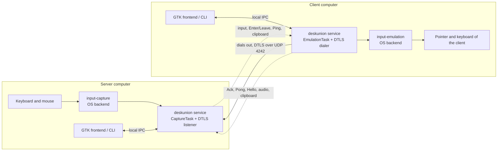
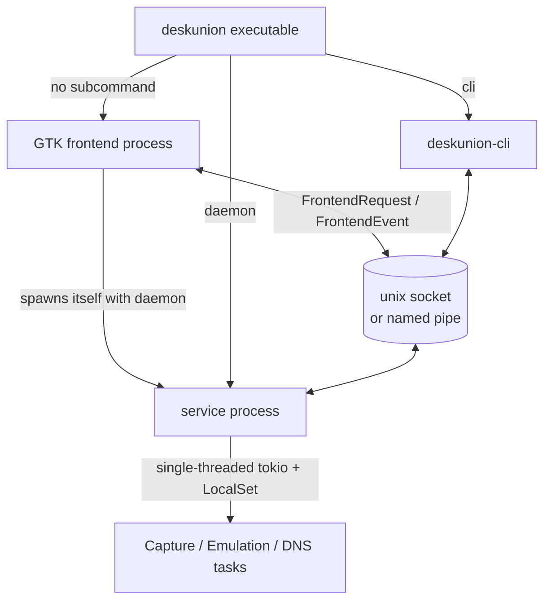
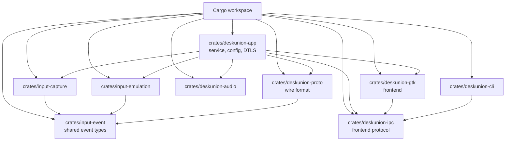
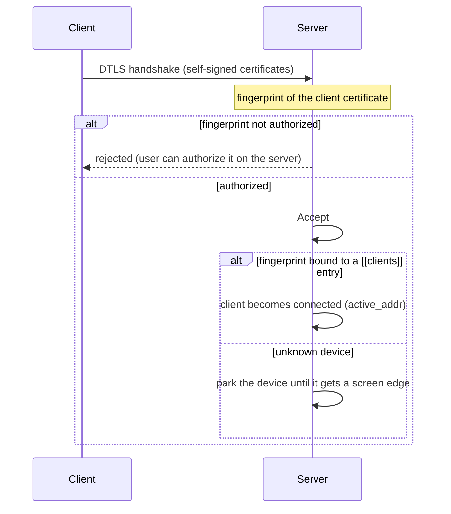
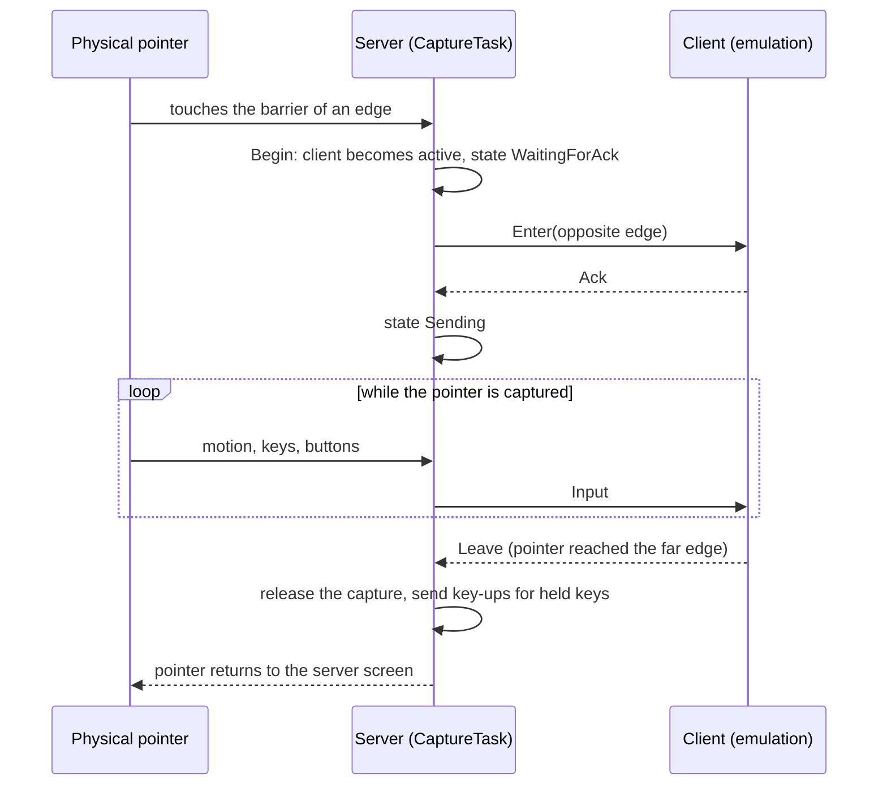
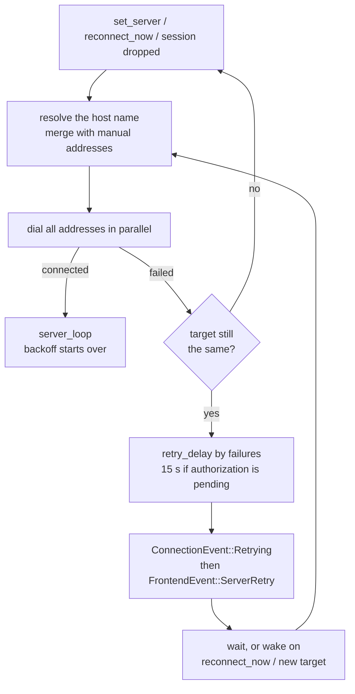
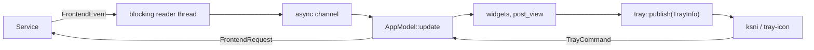

# DeskUnion Architecture

DeskUnion is an open-source software KVM: one keyboard and mouse control several
computers on a local network. The computer that owns the physical devices is the
**server** (it captures input); every computer it controls is a **client** (it
emulates input). Linux, Windows and macOS are supported, with a GTK4 +
Libadwaita frontend, a command line interface and a background service.

## System Context



Connections always go from client to server. Only the server listens (UDP, port
4242 by default), so only the server needs an open firewall port; clients work
behind NAT. The same DTLS association carries input events, control datagrams,
clipboard text and audio.

## Process Model



- Without a subcommand the executable starts the service as a child process and
  runs the GTK frontend; closing the frontend stops the child (SIGINT first on
  Unix). `deskunion daemon` runs only the service, which `service/deskunion.service`
  uses for a systemd user unit.
- The frontend never touches the network or the input devices. It talks to the
  service over a local-only channel: a unix socket on Unix and the named pipe
  `\\.\pipe\deskunion` on Windows. The `deskunion-cli` crate speaks the same
  protocol.
- The service runs on one thread (`tokio` current-thread runtime and a
  `LocalSet`), so its state uses `Rc`/`RefCell` rather than locks.

## Workspace Layout



## Main Crates

### `crates/deskunion-app`

The service and the `deskunion` binary. It owns configuration, pairing, the DTLS
transport and the coordination between capture, emulation and the frontends.

- `service.rs`: the `Service` event loop. Receives `FrontendRequest`s, capture and
  emulation events, DNS results, and answers with `FrontendEvent`s.
- `capture.rs`: `CaptureTask` on the server side. Owns the input-capture
  session, the DTLS listener events, the barriers of each client and the state
  machine of the active client (`WaitingForAck` then `Sending`).
- `listen.rs`: `DeskunionListener`, the DTLS listener. Accepts devices, runs the
  liveness pinger and the read loop of each connection, decodes datagrams into
  `ListenEvent`s.
- `emulation.rs` and `connect.rs`: the client side. `DeskunionConnection` dials the
  server, `server_loop` handles one established session, `connect_loop` retries.
- `retry.rs`: the reconnection schedule and the notice shown to the user.
- `client.rs`: `ClientManager`, the shared list of configured clients and their
  state (position, `active`, `active_addr`, `alive`, `ping_ms`, fingerprint).
- `config.rs`: `config.toml`, command line arguments, backend selection.
- `crypto.rs`: certificate generation and fingerprints. `dns.rs`: asynchronous
  resolution of client host names. `clipboard.rs`: text clipboard reassembly.
  `audio.rs`: glue to `deskunion-audio`.

### `crates/input-capture`

Turns the physical keyboard and mouse into a `Stream` of capture events and
grabs the pointer at screen edges. `InputCapture` wraps one backend and keeps
`id_map` and `position_map`, so several clients can share an edge. Backends are
tried in priority order when none is configured:

| Platform | Backends, in order |
|---|---|
| Linux | `input-capture-portal` (libei), `layer-shell`, `X11` |
| Windows | low-level mouse and keyboard hooks |
| macOS | event tap |
| tests | `dummy` |

`cursor_geometry.rs` holds the platform-independent geometry used by the Windows
cursor parking and is unit tested everywhere.

### `crates/input-emulation`

Replays events on the client through the `Emulation` trait (`consume`, `create`,
`destroy`, `terminate`). It tracks pressed keys and releases them when the
connection ends.

| Platform | Backends, in order |
|---|---|
| Linux | `wlroots`, `libei`, `xdg-desktop-portal` (RemoteDesktop), `X11` |
| Windows | `SendInput` |
| macOS | CoreGraphics events |
| tests | `dummy` |

### `crates/input-event`

Abstract pointer and keyboard events and the Linux scancode enums. New key
translations go here rather than in a backend.

### `crates/deskunion-proto`

The wire format. `ProtoEvent` covers `Input`, `Enter(position)`, `Leave(serial)`,
`Ack`, `Ping`, `Pong(emulation_active)` and `Hello{commit}`. Separate datagram
kinds carry the computer name (event id 17, 1 to 255 bytes of UTF-8), clipboard
fragments and acknowledgements, and audio frames and controls. Peers skip
datagram types they do not know, which keeps older versions compatible. A change
in the serialization needs a version bump.

### `crates/deskunion-ipc`

The local protocol between a frontend and the service: `FrontendRequest`
(`Activate`, `UpdatePosition`, `SetServiceRunning`, `ReconnectNow`, ...),
`FrontendEvent` (`State`, `ServerRetry`, `OperationMode`, `AudioStream`, ...) and
the serializable `ClientConfig` / `ClientState`. `connect.rs`, `connect_async.rs`
and `listen.rs` implement the sockets and pipes on both ends.

### `crates/deskunion-audio`

One-directional audio from client to server, parallel to the input pipeline. The
client captures its system output (WASAPI loopback on Windows, a PipeWire monitor
on Linux, CoreAudio loopback on macOS 14.6 or newer), encodes it with Opus and
sends it; the server decodes and plays it through a jitter buffer with
clock-drift compensation. The output device pulls from the buffer, so playback
follows the device clock. Behind the `audio` cargo feature (on by default).

### `crates/deskunion-gtk`

The Rust/Relm4 frontend, four pages: Connections, Audio, Logs and Settings.

- `app/mod.rs`: the `AppModel` component, its message handling and the state
  derived from `FrontendEvent`s.
- `screen_arrangement/`: the drag-and-drop canvas where screens are placed on the
  four edges.
- `factories/`: list rows (clients, parked devices, incoming devices, audio
  streams, fingerprints). `dialogs/`: add client, authorization, fingerprint.
- `server_link.rs`, `ping.rs`: user-facing text and levels for the retry notice and
  for the round-trip signal icon; pure and unit tested.
- `tray/`: tray icon and menu. `tray/menu.rs` builds the menu model for every
  platform; `linux.rs` (StatusNotifierItem through ksni) and `win32.rs`
  (`tray-icon`) only render it. `background.rs` talks to the Background Apps
  portal in a Flatpak. macOS uses a menu bar item (`macos_status_item.rs`).

### `crates/deskunion-cli`

Command line front end over the same IPC, for scripting and headless machines.

## Pairing



The stable identity of a device is its certificate fingerprint; source addresses
are only used to route datagrams. An authorized device that is not bound yet is
placed automatically on the first free edge (right, left, top, bottom) and waits
parked only when all four are taken. The binding is persisted as `fingerprint`
in the `[[clients]]` entry of `config.toml`. Only bound devices can be entered.

A client announces its computer name right after connecting and again every two
seconds. `ClientManager::set_announced_name` fills only an empty label of a bound
client and never overwrites a name the user typed.

## Input Handoff



While waiting for the `Ack`, the server repeats `Enter` instead of input, so a
lost datagram does not leave the client without the handoff. If a send fails
(the client is gone) the capture is released at once. A release bind
(`Ctrl+Shift+Alt+Meta` by default) returns the pointer to the server at any time;
before the `Leave`, the key-ups of every held key are synthesized so the peer
does not keep phantom modifiers.

### Capture barriers

A barrier at a screen edge makes the backend grab the pointer when it touches
it. `CaptureTask::sync_barriers` keeps the barriers of the backend equal to the
captures that want one: an `EnterOnly` capture (used to detect an incoming
handoff) always, a `Default` capture only while its client has an `active_addr`.
It runs after every listener event and every request, and a new capture session
starts from an empty set. A computer that is offline therefore never grabs the
pointer at its edge, on Linux through the portal or on Windows through the hook.
When the client that held the pointer loses its barrier, the pointer is released
first.

## Liveness and Link Quality

The listener is the pinger. Immediately after a device connects, and then every
5 seconds, it sends `Ping`; the client answers `Pong(emulation_active)`. Any
received datagram counts as proof of life, so a busy audio stream cannot trip the
keepalive; six consecutive probes without any datagram close the connection.

The listener also times each `Ping` against the `Pong` that answers it
(`Liveness::probed_at`) and reports `ListenEvent::Latency`, which is stored in
`ClientState::ping_ms` and shown in the client row as a signal icon and a value
in milliseconds. The icon steps are 20, 50 and 120 ms. The client has a mirrored
watchdog that closes the session when the server goes silent.

## Client Connection Retry



The schedule follows Deskflow's `ClientApp::retryTime`: 1 second for the first 300
consecutive failures, then 5, 10, 30, 60 and 120 seconds, and 5 minutes from the
430th. The host name is resolved before every attempt, so a network that comes up
late or a server that moves is picked up without restarting. A wake-up only
reaches a loop that is already waiting, so after a failed dial the loop checks
that its target is still current before announcing or sleeping. Waiting for the
server to authorize this computer uses a flat 15 seconds without backing off,
because older peers reopen their dialog on every rejected handshake.

## Frontend State



The model is the only owner of UI state. After every update `post_view`
publishes a `TrayInfo` (mode, whether sharing runs, status line, clients) to the
tray, which redraws only when it changed; tray actions come back as
`AppMsg::Tray` and reuse the requests the window already sends.

## Windows Specifics

- Capture uses low-level hooks (`WH_MOUSE_LL`, `WH_KEYBOARD_LL`) on a dedicated
  thread with its own message loop; emulation uses `SendInput`. Both are part of
  the software KVM behavior and are what endpoint-security products notice.
- While another computer is controlled, the cursor is parked at the center of the
  display it left from and the motion is measured from there. On return it is
  placed at the height it left, two pixels inside the crossed edge.
  `DESKUNION_PARK_CURSOR=0` turns the parking off.
- The capture thread declares per-monitor DPI awareness. The hook reports
  physical pixels and the display rectangles come from `EnumDisplaySettingsW`,
  also physical; `SetCursorPos` follows the DPI awareness of its thread and would
  otherwise scale its arguments, parking the cursor away from the center whenever
  the display scale is above 100%.
- Audio capture normally uses process loopback of every process except
  DeskUnion, which does not depend on the master volume. The Teams desktop client
  is silent in that stream, so `call_watch.rs` finds the outputs it plays on.
  Windows notifications (a session was created on an output, a Teams session
  changed state, an output was added or removed) only wake the watcher; it then
  recomputes the answer from the system, so a lost notification cannot leave it
  wrong. Because the session list may not show a new session at once, a wake-up
  is followed by quick looks for 2 s, and a look every 5 s covers anything never
  delivered. While an output has an active Teams session it is captured through
  endpoint loopback and the process loopback stops forwarding, since the output
  already holds every sound; `CallTracker` keeps the output for 3 s after the
  session goes quiet. The decision logic (`calls.rs`) and the mixer are unit
  tested; the WASAPI calls are only compiled and linted for Windows.
- Logs go to `%LOCALAPPDATA%\deskunion\deskunion.log`.

## Configuration and State

`config.toml` stores the operation mode, the capture and emulation backends
(when not automatic), the listen port, the certificate path, the release bind,
the server endpoint a client dials (`server_hostname`, `server_ips`,
`server_port`), the `authorized_fingerprints` of the server, the `[audio]` and
`[clipboard]` sections and the `[[clients]]` list with their position, port, host
name and fingerprint. Every field is optional, so older files keep loading. A
fresh installation has no operation mode and requests no permission until the
user chooses Server or Client. Each instance has exactly one
mode. In client mode the capture backend can still start later, only to detect
the handoff back to the server.

## Build and Release

- Features of `deskunion-app` select the backends (`layer_shell_capture`,
  `x11_capture`, `libei_capture`, `wlroots_emulation`, `libei_emulation`,
  `rdp_emulation`, `x11_emulation`) and the optional parts (`gtk`, `audio`).
  Gate OS-specific code at module level.
- Pushing a `v<version>` tag runs `release.yml`, which calls one reusable
  workflow per platform: a Windows installer and portable ZIP, a macOS DMG
  (`aarch64`), and a Flatpak and an AppImage for `x86_64` and `aarch64`, plus
  `SHA256SUMS.txt`. The tag must match the `deskunion-app` version.
- `rust.yml` runs the tests on every platform; the graphical tests run on Linux
  under a private D-Bus session and Xvfb with the Cairo renderer.
- Packaging inputs live in `build-aux/` (Flatpak manifest, Inno Setup), `data/`
  (icons), `service/` (systemd user unit), `nix/` and `scripts/`.

## Testing

```sh
cargo fmt --all --check
cargo clippy --workspace --all-targets --all-features -- -D warnings
cargo test --workspace

# Graphical flow with a fake service; no real input devices or peers.
cargo test -p deskunion-gtk --features ui-tests -- --test-threads=1

# Optional PNG captures into an existing directory.
DESKUNION_UI_CAPTURE_DIR=/tmp/captures \
  cargo test -p deskunion-gtk --features ui-tests app::ui_tests -- --test-threads=1
```

The `dummy` backends exercise the pipeline without real devices, and
`capture_test` / `emulation_test` run a backend by hand (`deskunion test-capture`,
`deskunion test-emulation`). Backends that need a real desktop (portals,
layer-shell, the Windows hooks and tray, macOS) are verified by running the
application on that platform.

## Not Verified

The behavior of the Windows cursor parking and tray, the macOS build and a real
suspend and resume cannot be exercised from CI. The GPU renderer, the declared
minimum library versions (GTK 4.14, libadwaita 1.5), the GNOME 50 Flatpak runtime
and screen-reader navigation have not been tested.
