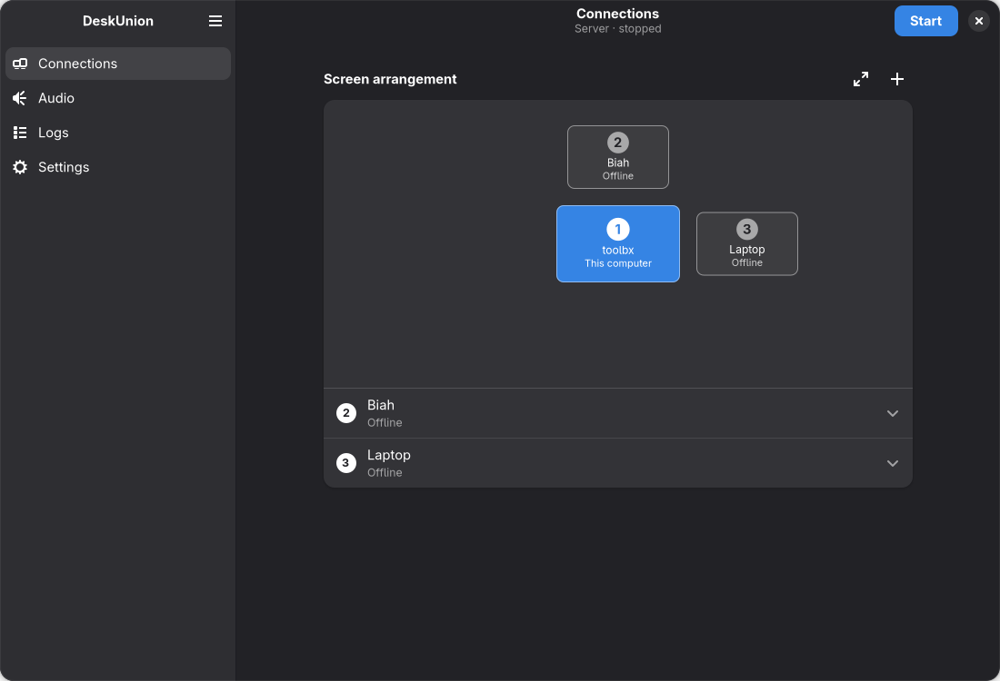

<p align="center">
  
</p>

<h1 align="center">DeskUnion</h1>

<p align="center">
  <a href="https://github.com/luminusOS/deskunion/releases/latest"></a>&nbsp;&nbsp;&nbsp;
  <a href="https://github.com/luminusOS/deskunion/releases"></a>&nbsp;&nbsp;&nbsp;
  <a href="https://github.com/luminusOS/deskunion/stargazers"></a>
</p>

<p align="center">
  <a href="https://github.com/luminusOS/deskunion/commits/main/"></a>
  <a href="https://github.com/luminusOS/deskunion/commits/main/"></a>
  <a href="LICENSE"></a>
  <a href="https://github.com/luminusOS/deskunion/actions/workflows/rust.yml"></a>
  <a href="https://github.com/luminusOS/deskunion/actions/workflows/release.yml"></a>
</p>

DeskUnion shares one mouse and keyboard across several computers on a local network, like Universal Control on Apple devices. It is an open-source alternative to [Synergy](https://symless.com/synergy), [ShareMouse](https://www.sharemouse.com/de/), [Deskflow](https://github.com/deskflow/deskflow) and [Input Leap](https://github.com/input-leap). DeskUnion is a hard fork of [lan-mouse](https://github.com/feschber/lan-mouse) by Ferdinand Schober. It is written in Rust and has a GTK4 and libadwaita frontend, optional client-to-server audio streaming, and builds for Linux, Windows, macOS and Android.

<picture>
    <source media="(prefers-color-scheme: dark)" srcset="/screenshots/ui-server-dark.png?raw=true">
    <source media="(prefers-color-scheme: light)" srcset="/screenshots/ui-server-light.png?raw=true">
    
</picture>

## Features

- Works on GNOME 45+, KDE Plasma 6.1+, wlroots compositors (Sway, Hyprland, Wayfire), Windows and macOS. See [OS support](docs/os-support.md).
- All traffic is encrypted with DTLS, using [WebRTC.rs](https://github.com/webrtc-rs/webrtc). There are no mitigations for timing side-channel attacks yet.
- Pairing by certificate fingerprint, with automatic placement on a free screen edge.
- Plain-text clipboard sharing between a Windows client and a GNOME Wayland server.
- Audio from a client played on the server. See [audio](docs/audio.md).
- Tray icon, CLI and daemon mode for running in the background.

## Install

Download a package from the [releases page](https://github.com/luminusOS/deskunion/releases): Flatpak and AppImage for Linux (x86_64 and aarch64), an installer and a ZIP for Windows, and APKs for Android. For example, with the Flatpak bundle:

```sh
flatpak install --user deskunion-<version>-linux-x86_64.flatpak
```

DeskUnion is not in the Luminus Flatpak repository, Arch Linux, Fedora or nixpkgs yet. Other install methods are in [docs/installation.md](docs/installation.md), and building from source is in [docs/building.md](docs/building.md).

## Quick start

1. On the computer with the physical mouse and keyboard, run `deskunion` and choose "Share this keyboard and mouse". It listens on UDP port `4242`.
2. On each computer you want to control, choose "Use another computer's keyboard", enter the server's address and click Connect.
3. Authorize the client on the server when the fingerprint dialog appears. The client is placed on the first free screen edge.

Only the server needs an open firewall port. Clients dial out and work through NAT. See [docs/usage.md](docs/usage.md) for pairing, the tray, clipboard, the CLI and the systemd service.

## Documentation

- [Usage](docs/usage.md)
- [Configuration](docs/configuration.md)
- [Audio streaming](docs/audio.md)
- [OS support, known issues and roadmap](docs/os-support.md)
- [Installation](docs/installation.md) and [building from source](docs/building.md)
- [Architecture](ARCHITECTURE.md)
- [Nix flake](nix/README.md)
